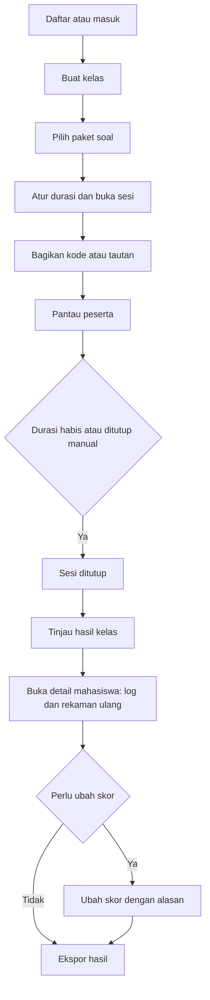
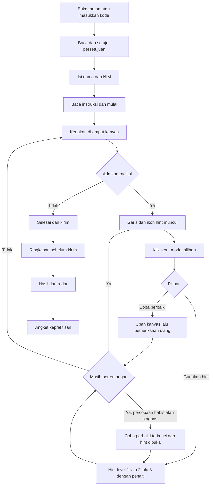

# FisGrade — UI/UX Wireframes & User Flow

Versi 1.0 | 25 Oktober 2026 | Mengacu pada PRD v1.0 dan TDD v1.0 | Tema: putih pendidikan dengan warna utama Navy Blue dan Pure White

Wireframe pada dokumen ini berbentuk sketsa teks (skala abu) sebagai panduan membuat desain di Figma. Seluruh teks antarmuka berbahasa Indonesia.

## 1. Prinsip Desain

1. **Tenang dan akademis:** latar putih, ruang kosong lega, satu warna utama navy; fokus pada tugas.
2. **Satu layar, empat kanvas setara:** keempat representasi selalu terlihat bersamaan agar hubungan antarrepresentasi mudah dibandingkan.
3. **Umpan balik halus:** kontradiksi ditandai garis dan ikon kecil; penjelasan hanya muncul saat diklik.
4. **Mahasiswa memegang kendali:** pilihan Coba perbaiki dan Gunakan hint selalu tersedia dengan akibat yang dijelaskan sebelum dipilih.
5. **Transparansi bagi dosen:** log dan rekaman ulang proses mudah diakses dari detail mahasiswa.
6. **Tanpa gamifikasi:** tidak ada XP, koin, level, atau papan peringkat.
7. **Aksesibel:** kontras tinggi, tidak bergantung pada warna saja, alternatif keyboard dan form untuk kanvas.

## 2. Sistem Desain

### 2.1 Warna

Rasio kontras di bawah adalah perkiraan terhadap latar putih (#FFFFFF); verifikasi dengan alat pemeriksa kontras sebelum finalisasi.

| Token | Hex | Penggunaan | Perkiraan kontras |
| --- | --- | --- | --- |
| white | #FFFFFF | Latar utama, kartu, modal | — |
| navy-900 | #071B3D | Judul, teks utama, bilah atas gelap | ≈ 17:1 |
| navy-700 (primer) | #0B2A5B | Tombol primer, tautan, ikon aktif, garis radar | ≈ 14:1 |
| navy-500 | #1F4E9C | Hover dan fokus, status berjalan | ≈ 8:1 |
| navy-100 | #E6ECF7 | Latar lembut, baris terpilih, badge info | latar |
| gray-50 | #F6F8FB | Latar halaman sekunder | latar |
| gray-200 | #D9DFEA | Garis, batas kartu | — |
| gray-600 | #4B5568 | Teks sekunder | ≈ 7:1 |
| success | #166534 | Dikirim, benar | ≈ 7:1 |
| warning | #B45309 | Garis kontradiksi, belum terselesaikan | ≈ 5:1 |
| error | #B91C1C | Galat, tindakan destruktif | ≈ 6:1 |

Aturan: navy sebagai satu-satunya warna merek; warna semantik hanya untuk status. Warna tidak pernah menjadi satu-satunya pembawa makna (selalu ada ikon atau teks).

### 2.2 Tipografi

Famili: Inter (cadangan: system-ui, sans-serif).

| Gaya | Ukuran/tinggi baris | Bobot |
| --- | --- | --- |
| H1 | 28/36 | Semibold |
| H2 | 22/30 | Semibold |
| H3 | 18/26 | Semibold |
| Isi | 16/24 | Regular |
| Kecil | 14/20 | Regular |
| Keterangan | 12/16 | Regular |

Angka pada tabel dan skor memakai tabular numerals. Persamaan memakai font papan ketik matematis.

### 2.3 Tata letak dan bentuk

- Kisi 12 kolom, lebar kontainer maksimum 1280 px, spasi kelipatan 8 px.
- Radius 8 px (kartu dan modal 12 px); garis 1 px gray-200; bayangan sangat tipis (0 1px 2px dengan navy 8%).
- Titik henti: ≥ 1280 optimal; 1024–1279 padat; < 1024 mahasiswa melihat layar peringatan, dasbor dosen tetap responsif dengan tabel dapat digulir.

### 2.4 Komponen

| Komponen | Spesifikasi |
| --- | --- |
| Tombol primer | Latar navy-700, teks putih, tinggi 44 px; hover navy-500; nonaktif abu |
| Tombol sekunder | Garis navy-700, teks navy-700, latar putih |
| Tombol tersier | Teks navy-700 tanpa garis |
| Tombol destruktif | Garis atau latar error, hanya untuk hapus dan keluar |
| Input | Garis gray-200, fokus cincin navy-500 2 px, label di atas, pesan galat di bawah dengan ikon |
| Kartu | Latar putih, garis gray-200, padding 24 px |
| Tabel | Header navy-100 teks navy-900, baris 48 px, baris terpilih navy-100 |
| Badge status | Belum mulai (abu), Mengerjakan (navy-500), Dikirim (success), Belum terselesaikan (warning); selalu berisi teks |
| Modal | Overlay navy-900 50%, kartu putih, fokus terkunci di dalam, Esc menutup |
| Toast | Kanan atas, otomatis hilang 5 detik, aria-live polite |
| Pewaktu | Teks dengan ikon jam; berubah warning pada 5 menit terakhir disertai teks |
| Tab dan stepper | Garis bawah navy-700 pada tab aktif |
| Tooltip | Latar navy-900, teks putih, muncul saat fokus dan hover |

### 2.5 Grafik radar belah ketupat

- Empat sumbu: Verbal (atas), Matematis (kanan), Visual (bawah), Grafis (kiri); skala 0–100 dengan cincin setiap 25.
- Area berisi navy-700 dengan opasitas 18%, garis navy-700 2 px, titik putih bergaris navy.
- Nilai angka dicetak di ujung setiap sumbu sehingga tidak bergantung pada warna.
- Representasi berstatus belum terselesaikan ditandai ikon peringatan pada label sumbu.

### 2.6 Kanvas dan penanda kontradiksi

- Panel diberi nomor dan judul; bingkai netral gray-200, panel aktif berbingkai navy-500.
- Panah gaya dan elemen kanvas memakai navy-700; elemen terpilih diberi pegangan putih bergaris navy.
- Garis kontradiksi: putus-putus 2 px warna warning; ikon hint di titik tengah berupa lingkaran navy-700 berisi bola lampu putih dengan cincin warning. Ikon berukuran minimal 32 px dan dapat difokus dengan keyboard.
- Elemen yang terlibat disorot dengan cincin tipis warning pada kedua ujung garis.

### 2.7 Gerak

Transisi 150–200 ms; garis kontradiksi muncul dengan pudar singkat; hormati pengaturan prefers-reduced-motion (tanpa animasi).

## 3. Arsitektur Informasi

```
Publik
  Beranda (W-01) -> Masuk dosen / Daftar dosen (W-02) / Gabung sesi (W-03)
Mahasiswa (tanpa akun)
  Gabung sesi -> Persetujuan (W-04) -> Identitas (W-05) -> Instruksi (W-06)
  -> Kanvas kuadran (W-07) [Modal dikte W-08, Kontradiksi W-09, Modal hint W-10,
     Hint bertingkat W-11] -> Ringkasan (W-12) -> Hasil (W-13) -> Angket (W-14)
Dosen
  Daftar kelas (W-15) -> Buat kelas (W-16) -> Detail kelas (W-17)
  -> Katalog paket (W-18) -> Buka sesi (W-19) -> Pemantauan (W-20)
  -> Hasil sesi (W-21) -> Detail mahasiswa (W-22) -> Rekaman ulang (W-23)
Admin
  Paket dan harness uji (W-24)
Sistem
  Layar status: layar terlalu kecil, sesi tidak ditemukan, sesi ditutup, galat (W-25)
```

## 4. Alur Pengguna

### 4.1 Alur dosen



### 4.2 Alur mahasiswa



### 4.3 Alur siklus kontradiksi (rincian)

1. Mahasiswa berhenti mengubah kanvas selama jeda pemeriksaan (bawaan 7 detik).
2. Sistem memeriksa; bila ditemukan kontradiksi pada elemen yang sudah lengkap, garis putus-putus dan ikon hint muncul. Skor representasi terkait ditahan.
3. Mahasiswa mengklik ikon dan melihat modal: Sepertinya ada ketidaksesuaian di sini, dengan dua tombol, Coba perbaiki dan Gunakan hint, beserta keterangan akibat setiap pilihan.
4. Coba perbaiki: modal menutup, mahasiswa mengubah kanvas. Bila pemeriksaan ulang masih menemukan kontradiksi yang sama, percobaan bertambah satu. Setelah percobaan habis atau tidak ada perubahan bermakna selama ambang stagnasi, Coba perbaiki terkunci sementara dan hint level 1 dibuka.
5. Gunakan hint: level 1 menyebut lokasi dan bagian yang sudah benar; level 2 jenis kesalahan; level 3 petunjuk koreksi eksplisit tanpa jawaban akhir (tombol aktif setelah jeda). Setiap level mengurangi batas skor representasi yang dibantu.
6. Bila pemeriksaan ulang bersih, garis dan ikon hilang dan skor representasi dilepas.
7. Bila waktu habis saat kontradiksi aktif, representasi ditandai Belum terselesaikan dan diteruskan ke dosen.

### 4.4 Kasus tepi dan galat

| Kasus | Perilaku antarmuka |
| --- | --- |
| Kode sesi salah atau sesi belum dibuka | Pesan di kolom kode; tombol tetap aktif |
| Sesi sudah ditutup | Layar status W-25 dengan petunjuk menghubungi dosen |
| Koneksi terputus | Banner Koneksi terputus, perubahan disimpan lokal dan dikirim ulang; pemeriksaan ditunda |
| Mahasiswa menutup tab lalu masuk lagi | Masuk ulang dengan kode lalu NIM yang sama memulihkan pekerjaan |
| LLM gagal atau lambat | Hasil aturan tampil; keterangan kecil Pemeriksaan makna tertunda |
| Mikrofon tidak tersedia atau ditolak | Tombol mikrofon nonaktif dengan tooltip penjelasan; ketik tetap tersedia |
| Transkrip dikte kosong atau salah | Pengguna menyunting di modal sebelum menekan Gunakan teks |
| Layar < 1024 px | Layar peringatan: gunakan perangkat dengan layar lebih lebar atau putar ke lanskap |
| Waktu habis | Pengiriman otomatis; representasi berkontradiksi aktif ditandai Belum terselesaikan |
| Klik ganda Kirim | Tombol nonaktif setelah klik pertama; pengiriman idempoten |
| Grafik tanpa nama sumbu | Kontradiksi tidak ditandai; label sumbu bertanda wajib diisi |

## 5. Wireframe Publik dan Mahasiswa

Legenda: \[Tombol\], \[\_\_\_\_\] input, (o) pilihan terpilih, ( ) pilihan, ( \* ) ikon hint. Setiap wireframe diikuti catatan perilaku, keadaan, dan konten.

### W-01 Beranda

```
+----------------------------------------------------------------------+
| [F] FisGrade                                  [Masuk]  [Daftar]      |
+----------------------------------------------------------------------+
|  Asesmen fisika yang memandu proses berpikir                         |
|  Empat representasi, satu layar, umpan balik saat Anda bekerja.      |
|                                                                      |
|  +------------------------------+   +-----------------------------+  |
|  | Untuk Dosen                  |   | Untuk Mahasiswa             |  |
|  | Buat kelas dan buka sesi.    |   | Masukkan kode sesi          |  |
|  | [Masuk sebagai dosen]        |   | [ _ _ _ _ _ _ ]  [Gabung]  |  |
|  +------------------------------+   +-----------------------------+  |
|                                                                      |
|  Ilustrasi empat kuadran: Verbal | Visual | Matematis | Grafis       |
+----------------------------------------------------------------------+
```

Catatan: latar putih, judul navy-900, tombol primer navy-700. Kode sesi 6 karakter, huruf kapital otomatis. Galat kode ditampilkan di bawah kolom.

### W-02 Masuk dan daftar dosen

```
+---------------------------------------+
|  Masuk sebagai dosen                  |
|  Email      [______________________]  |
|  Kata sandi [______________________]  |
|  [Masuk]        Lupa kata sandi?      |
|  Belum punya akun? [Daftar]           |
+---------------------------------------+
```

Catatan: formulir daftar menambahkan nama dan konfirmasi kata sandi. Galat per kolom; tombol menampilkan keadaan memuat.

### W-03 Gabung sesi

```
+---------------------------------------+
|  Gabung sesi                          |
|  Kode sesi  [ A B C 1 2 3 ]           |
|  [Lanjutkan]                          |
|  Sesi: Hukum Newton - Kelas A         |
+---------------------------------------+
```

Catatan: tautan sesi mengisi kode otomatis. Nama sesi tampil setelah kode valid.

### W-04 Persetujuan

```
+----------------------------------------------------------------------+
|  Persetujuan penggunaan data                                         |
|  Tujuan: asesmen formatif fisika dan penelitian pengembangan sistem. |
|  Data diproses: jawaban kanvas, log proses, skor, nama dan NIM       |
|  (disimpan terpisah dengan ID acak).                                 |
|  Pemeriksaan makna jawaban memakai layanan LLM pihak ketiga; hanya   |
|  ID acak dan data terstruktur yang dikirim, tanpa nama dan NIM.      |
|  Audio dikte tidak disimpan. Anda dapat menolak atau menarik         |
|  persetujuan; hubungi dosen atau peneliti.                           |
|  [ ] Saya telah membaca dan menyetujui                               |
|  [Kembali]                                    [Setuju dan lanjutkan] |
+----------------------------------------------------------------------+
```

Catatan: tombol Setuju aktif hanya setelah kotak dicentang. Versi teks persetujuan dicatat. Isi final mengikuti komite etik.

### W-05 Identitas

```
+---------------------------------------+
|  Identitas Anda                       |
|  Nama  [______________________]       |
|  NIM   [______________________]       |
|  Data ini disimpan terpisah dari      |
|  jawaban Anda.                        |
|  [Mulai]                              |
+---------------------------------------+
```

### W-06 Instruksi sebelum mulai

```
+----------------------------------------------------------------------+
|  Hukum Newton | Durasi 45 menit | 1 soal                             |
|  Cara mengerjakan:                                                   |
|  1. Jawab melalui empat kanvas: Verbal, Visual, Matematis, Grafis.   |
|  2. Sistem memeriksa kesesuaian antarkanvas saat Anda berhenti       |
|     mengetik beberapa detik.                                         |
|  3. Garis putus-putus dengan ikon bola lampu menandai               |
|     ketidaksesuaian. Klik ikon untuk pilihan.                        |
|  4. Hint membantu tetapi menurunkan batas skor representasi terkait. |
|  5. Skor ditampilkan per representasi (0-100).                       |
|  [Mulai mengerjakan]                                                 |
+----------------------------------------------------------------------+
```

Catatan: pewaktu mulai setelah tombol ditekan (waktu dihitung server).

### W-07 Kanvas kuadran (layar utama)

```
+--------------------------------------------------------------------------+
| FisGrade | Hukum Newton - Soal 1/1    Tersimpan   Sisa 44:20     [Keluar]   |
+--------------------------------------------------------------------------+
| SOAL  Balok 5 kg ditarik F = 30 N ke kanan di bidang datar kasar         |
|       (mu_k = 0,2; g = 10 m/s2). Jelaskan gaya dan tunjukkan geraknya.    |
+-------------------------------------+------------------------------------+
| 1 VERBAL           [Mic] [Hapus]    | 2 VISUAL     [Undo] [Redo] [Hapus] |
| +---------------------------------+ | +-------------------+ +----------+ |
| | Ketik penjelasan Anda ...       | | |  (kanvas gambar)  | | ASET     | |
| |                                 | | |                   | | [Balok]  | |
| |                                 | | |                   | | [Datar]  | |
| |                          0/1500 | | |                   | | [Miring] | |
| +---------------------------------+ | +-------------------+ | [Katrol] | |
|                                     | [+ Gaya] Nama [___]   | [Tali]   | |
|                                     | Arah [___] Panjang [_]+----------+ |
+-------------------------------------+------------------------------------+
| 3 MATEMATIS         [Undo] [Redo]   | 4 GRAFIS      Jenis [v-t  v]       |
| +---------------------------------+ | Sumbu X [t   ] [s   ]              |
| | 1. sum F = m a                  | | Sumbu Y [v   ] [m/s ]              |
| | 2. F - f_k = m a                | | +--------------------------------+ |
| | 3. [ketik persamaan ...]        | | |  (grid dan kurva)              | |
| +---------------------------------+ | +--------------------------------+ |
| [ Papan ketik persamaan  ^ ]        | Masukan (o) Penggeser ( ) Titik    |
|                                     | [Haluskan bentuk]  [Batalkan]      |
+-------------------------------------+------------------------------------+
| [Periksa sekarang]                                  [Selesai dan Kirim]  |
+--------------------------------------------------------------------------+
```

Perilaku utama:

- Keempat panel selalu terlihat; panel aktif berbingkai navy-500. Pada layar 1024 px, panel aset visual dapat dilipat.
- Penyimpanan otomatis dengan indikator Menyimpan, lalu Tersimpan; kegagalan menampilkan Belum tersimpan.
- Verbal: ketik atau tombol Mic yang membuka W-08.
- Visual: seret aset ke kanvas; tombol + Gaya membuat panah dari titik tangkap; setiap panah memiliki kolom nama (misalnya N, W, F, f\_k), arah (derajat), dan panjang relatif; mode form ini juga menjadi alternatif keyboard.
- Matematis: papan ketik persamaan terbuka dari tombol di bawah panel; berisi pecahan, pangkat, indeks bawah, akar, huruf Yunani, operator, fungsi trigonometri, simbol vektor, dan satuan; setiap baris divalidasi sintaksnya.
- Grafis: jenis grafik (x-t, v-t, a-t, F-t); sumbu wajib diberi nama dan satuan; masukan lewat penggeser dari titik awal ke akhir atau penempatan titik; Haluskan bentuk merapikan menjadi linear, kuadratik, atau konstan tanpa mengubah kemiringan atau nilai; Batalkan mengembalikan goresan asli.
- Tombol Periksa sekarang memicu pemeriksaan tanpa menunggu jeda; Selesai dan Kirim membuka W-12.
- Keadaan: memuat soal, kanvas kosong (petunjuk samar di tiap panel), koneksi terputus, pemeriksaan berjalan (spinner kecil di bilah atas), pemeriksaan makna tertunda.

### W-08 Modal transkrip dikte

```
+--------------------------------------------------+
|  Dikte suara                              [X]    |
|  Status: ( * ) Merekam ...   [Berhenti]          |
|  Transkrip (dapat disunting):                    |
|  +--------------------------------------------+  |
|  | Gaya tarik tiga puluh newton melawan ...   |  |
|  +--------------------------------------------+  |
|  Periksa istilah fisika sebelum digunakan.       |
|  [Batal]  [Rekam ulang]       [Gunakan teks]     |
+--------------------------------------------------+
```

Catatan: transkrip tampil dulu dan dapat disunting; baru masuk ke kanvas verbal setelah Gunakan teks. Audio tidak disimpan. Bila mikrofon ditolak, tampil pesan dan tombol Mic nonaktif.

### W-09 Kontradiksi pada kanvas (keadaan)

```
 VISUAL (kanan atas)                      MATEMATIS (kiri bawah)
   [Balok] ---> F                           1. sum F = m a
   <--- f_k   (arah ke kiri)                2. F + f_k = m a   <- elemen bermasalah
       :                                              ^
       :                                              :
       +- - - - - - - - - - ( * ) - - - - - - - - - -+
                          ikon hint (dapat difokus)
```

Catatan: garis putus-putus warning menghubungkan elemen sumber dan tujuan lintas panel (diambil dari id elemen). Ikon di titik tengah berlabel aksesibel: Ada ketidaksesuaian antara panah f\_k dan persamaan baris 2. Kedua ujung disorot cincin tipis. Skor representasi terkait ditahan. Garis hilang setelah pemeriksaan ulang bersih.

### W-10 Modal ketidaksesuaian

```
+----------------------------------------------------------+
|  Sepertinya ada ketidaksesuaian di sini            [X]   |
|  Panah f_k di kanvas Visual dan persamaan baris 2 di     |
|  kanvas Matematis belum sejalan.                         |
|                                                          |
|  [ Coba perbaiki ]        [ Gunakan hint ]               |
|  Sisa percobaan: 2 dari 3                                |
|  Hint menurunkan batas skor representasi yang dibantu.   |
+----------------------------------------------------------+
```

Catatan: bila percobaan habis atau stagnasi, tombol Coba perbaiki nonaktif disertai alasan, dan hint level 1 dibuka. Teks akibat penalti ditampilkan sebelum pilihan.

### W-11 Hint bertingkat

```
+----------------------------------------------------------+
|  Hint (level 1 dari 3)                             [X]   |
|  Bagian yang sudah benar: Grafis                         |
|  Periksa hubungan antara panah f_k (Visual) dan baris 2  |
|  persamaan (Matematis).                                  |
|  Penalti: batas skor Visual dan Matematis -5             |
|  [Kembali memperbaiki]        [Hint level 2]             |
+----------------------------------------------------------+
```

Catatan: level 2 menyebut jenis kesalahan; level 3 memberi petunjuk koreksi eksplisit, tombolnya aktif setelah hitung mundur beberapa detik, dan tidak memuat jawaban akhir. Ringkasan penalti kumulatif per representasi ditampilkan di panel samping ringkasan.

### W-12 Ringkasan sebelum kirim

```
+----------------------------------------------------------------------+
|  Tinjau sebelum mengirim                                             |
|  Verbal      Terisi                                                  |
|  Visual      Terisi, 1 kontradiksi selesai                           |
|  Matematis   Terisi, 1 hint dipakai (batas skor 95)                  |
|  Grafis      Terisi                                                  |
|  ! Masih ada ketidaksesuaian pada: Visual dan Matematis (belum       |
|    selesai). Anda dapat kembali memperbaiki.                         |
|  [Kembali ke kanvas]                           [Kirim jawaban]       |
+----------------------------------------------------------------------+
```

Catatan: bila kontradiksi aktif, pengiriman tetap dapat dilakukan; representasi terkait ditandai Belum terselesaikan dan diteruskan ke dosen. Tombol menjadi nonaktif setelah klik pertama.

### W-13 Hasil mahasiswa

```
+----------------------------------------------------------------------+
|  Hasil Anda | Hukum Newton                                           |
|  +-----------------------------+   Rincian                           |
|  |            Verbal 85        |   Representasi  Rubrik Penalti Skor |
|  |               *             |   Verbal          85     0      85  |
|  |  Grafis 90 *       * Matem  |   Matematis       95    -5      90  |
|  |               *      70     |   Visual          90     0      90  |
|  |            Visual 90        |   Grafis          70   (belum selesai)|
|  +-----------------------------+                                     |
|  Kekuatan: Visual dan Verbal. Perlu diperbaiki: Matematis (tanda    |
|  suku gesek). Skor akhir dapat disesuaikan dosen.                    |
|  [Isi angket kepraktisan]                                            |
+----------------------------------------------------------------------+
```

Catatan: angka pada wireframe hanya contoh. Radar belah ketupat empat sumbu (atas Verbal, kanan Matematis, bawah Visual, kiri Grafis). Representasi belum terselesaikan memakai ikon peringatan dan keterangan menunggu keputusan dosen. Hasil muncul setelah dosen merilis atau sesi ditutup.

### W-14 Angket kepraktisan

```
+----------------------------------------------------------------------+
|  Bantu kami menilai FisGrade                                         |
|  Kemudahan penggunaan   1 ( ) 2 ( ) 3 ( ) 4 ( ) 5 ( )               |
|  Kemenarikan visual     1 ( ) 2 ( ) 3 ( ) 4 ( ) 5 ( )               |
|  Kejelasan petunjuk     1 ( ) 2 ( ) 3 ( ) 4 ( ) 5 ( )               |
|  Kemanfaatan            1 ( ) 2 ( ) 3 ( ) 4 ( ) 5 ( )               |
|  Kendala yang Anda temui:                                            |
|  [_____________________________________________________________]    |
|  Saran perbaikan:                                                    |
|  [_____________________________________________________________]    |
|  [Kirim]                                                             |
+----------------------------------------------------------------------+
```

Catatan: setiap indikator memiliki beberapa butir pada versi final; wireframe memperlihatkan satu butir per indikator. Skala 1 sangat tidak setuju sampai 5 sangat setuju. Kolom kualitatif dikategorikan dosen atau peneliti: substansi materi, tampilan, operasional teknis.

## 6. Wireframe Dosen dan Admin

### W-15 Daftar kelas

```
+----------------------------------------------------------------------+
| FisGrade     Kelas | Paket soal | Admin            Dr. Nama   [Keluar] |
+----------------------------------------------------------------------+
|  Kelas saya                                          [+ Buat kelas]  |
|  +----------------------+  +----------------------+                  |
|  | Fisika Dasar - A     |  | Mekanika - B         |                  |
|  | 2 sesi, 38 mhs       |  | 1 sesi, 40 mhs       |                  |
|  | [Buka]               |  | [Buka]               |                  |
|  +----------------------+  +----------------------+                  |
+----------------------------------------------------------------------+
```

Keadaan kosong: ilustrasi sederhana dan teks Belum ada kelas, tombol Buat kelas.

### W-16 Buat kelas

```
+---------------------------------------+
|  Buat kelas                           |
|  Nama kelas   [____________________]  |
|  Mata kuliah  [____________________]  |
|  Semester     [____ v]                |
|  [Batal]                  [Simpan]    |
+---------------------------------------+
```

### W-17 Detail kelas

```
+----------------------------------------------------------------------+
|  < Kelas  |  Fisika Dasar - A                  [+ Buka sesi baru]    |
|  Sesi                                                                |
|  Judul               Paket          Status      Peserta   Aksi        |
|  Newton - Pertemuan1 Hukum Newton   Ditutup     38        [Hasil]     |
|  Newton - Pertemuan2 Hukum Newton   Berjalan    22/38     [Pantau]    |
+----------------------------------------------------------------------+
```

### W-18 Katalog paket soal dan pratinjau

```
+----------------------------------------------------------------------+
|  Paket soal                                                          |
|  +---------------------------------+  Pratinjau                      |
|  | ( ) Hukum Newton tentang gerak  |  Soal 1: Balok 5 kg ditarik ... |
|  |     v1.0 | 1 soal | 45 menit    |  Representasi dinilai: 4        |
|  +---------------------------------+  Kunci dan rubrik (khusus dosen)|
|                                       [Lihat kunci]  [Pilih paket]   |
+----------------------------------------------------------------------+
```

Catatan: dosen tidak dapat mengedit soal; ikon gembok dan keterangan Dikelola sistem.

### W-19 Buka sesi

```
+----------------------------------------------------------------------+
|  Buka sesi baru                                                      |
|  Judul sesi  [Newton - Pertemuan 2]                                  |
|  Paket       Hukum Newton tentang gerak (v1.0)                       |
|  Durasi      [45] menit        Rilis hasil (o) Otomatis ( ) Manual    |
|  [Buka sesi]                                                         |
|  ------------------------------------------------------------------  |
|  Kode sesi:  ABC123   [Salin]                                        |
|  Tautan:     https://fisgrade.example/gabung/ABC123   [Salin]        |
|  [Kode QR]                                                           |
+----------------------------------------------------------------------+
```

Catatan: setelah dibuka, versi paket dibekukan dan tampil keterangan Versi paket dikunci.

### W-20 Pemantauan langsung

```
+----------------------------------------------------------------------+
|  Newton - Pertemuan 2 | Berjalan | Sisa 31:10 | [Tutup sesi]         |
|  Peserta 22/38     Mengerjakan 18   Dikirim 4                        |
|  Nama (ID)        Status         Kontradiksi aktif   Hint            |
|  Ahmad F. (7f3a)  Mengerjakan    1                   2               |
|  Alya N. (b21c)   Dikirim        0                   0               |
+----------------------------------------------------------------------+
```

Catatan: pembaruan melalui SSE; tabel dapat diurutkan dan dicari. Nama dibaca dari skema identitas hanya untuk tampilan dosen.

### W-21 Hasil sesi (ringkasan kelas)

```
+----------------------------------------------------------------------+
|  Hasil: Newton - Pertemuan 2               [Ekspor CSV] [Ekspor XLSX]|
|  +-------------------------+   Miskonsepsi tersering (indikasi)       |
|  | Radar rata-rata kelas   |   E-P4-01 Tanda suku gesek    45% (17)   |
|  +-------------------------+   E-P5-01 Kemiringan vs a     28% (11)   |
|  Distribusi skor per representasi (histogram)                       |
|  Nama        Verbal Matem Visual Grafis  Status        Aksi          |
|  Ahmad F.      85     90    90    70    Perlu tinjau   [Detail]      |
+----------------------------------------------------------------------+
```

Catatan: label Indikasi, bukan kepastian pada panel miskonsepsi. Baris berstatus Belum terselesaikan diberi badge warning dan diurutkan lebih atas.

### W-22 Detail mahasiswa (log dan ubah skor)

```
+----------------------------------------------------------------------+
|  < Hasil | Ahmad F. (7f3a) | Dikirim 10:42                           |
|  Radar (belah ketupat)      Skor per representasi                    |
|                             Rep.      Otomatis  Dosen    Aksi        |
|                             Matematis    90     [ 90 ]   [Simpan]    |
|                             Alasan perubahan: [_____________]        |
|  Log kejadian               [Putar ulang proses]                     |
|  09:51  Kontradiksi E-P4-01 (Visual-Matematis) ditemukan             |
|  09:53  Percobaan 1                                                  |
|  09:55  Hint level 1 (penalti 5 pada Matematis)                      |
|  09:58  Kontradiksi selesai                                          |
+----------------------------------------------------------------------+
```

Catatan: alasan perubahan wajib; riwayat perubahan (nilai lama, baru, penyunting, waktu) tampil di bawah tabel skor.

### W-23 Rekaman ulang

```
+----------------------------------------------------------------------+
|  Putar ulang: Ahmad F. (7f3a)                                        |
|  +----------------------- keempat kanvas ------------------------+   |
|  |  Verbal | Visual | Matematis | Grafis (keadaan pada waktu t)  |   |
|  +----------------------------------------------------------------+   |
|  [|<] [Putar] [>|]   Kecepatan 1x v     00:07:12 ----o------- 00:44:00|
|  Penanda: K1 kontradiksi  H1 hint  OK selesai                        |
+----------------------------------------------------------------------+
```

Catatan: pemutar menerapkan event pada keadaan kosong; penanda pada garis waktu dapat diklik. Tidak ada audio.

### W-24 Admin: paket dan harness uji

```
+----------------------------------------------------------------------+
|  Admin | Paket | Parameter | Harness uji                             |
|  Harness skenario                                  [Jalankan semua]  |
|  No  Skenario                      Terdeteksi   Catatan              |
|  1   Arah gaya gesek               Ya                                 |
|  8   Konsisten tetapi salah       Tidak        Perbaiki aturan R-X-01 |
|  10  Kontrol (tanpa kesalahan)     Tidak ada alarm                    |
+----------------------------------------------------------------------+
```

### W-25 Layar status

```
+---------------------------------------+
|  Layar terlalu kecil                  |
|  Gunakan laptop atau tablet dengan    |
|  layar lebar, atau putar ke lanskap.  |
|  [Coba lagi]                          |
+---------------------------------------+
```

Varian: Sesi tidak ditemukan, Sesi sudah ditutup, Terjadi galat (dengan kode korelasi dan tombol coba lagi).

## 7. Teks Antarmuka (Microcopy)

**Pesan umum**

| Konteks | Teks |
| --- | --- |
| Penyimpanan | Menyimpan..., Tersimpan, Belum tersimpan, coba lagi |
| Koneksi | Koneksi terputus. Pekerjaan Anda aman dan akan disimpan saat tersambung kembali |
| Pemeriksaan | Memeriksa kesesuaian..., Pemeriksaan makna tertunda |
| Waktu | Sisa 05:00; Waktu habis, jawaban dikirim otomatis |
| Konfirmasi kirim | Kirim jawaban? Anda tidak dapat mengubahnya setelah dikirim |

**Templat hint per kode kesalahan (contoh)**

| Kode | Level 1 | Level 2 | Level 3 |
| --- | --- | --- | --- |
| E-P4-01 | Bagian yang sudah benar: {rep\_benar}. Periksa hubungan antara panah {label\_gaya} (Visual) dan baris {no\_baris} persamaan | Jenis kesalahan: tanda atau arah. Periksa apakah panah dan tanda suku sama-sama menyatakan gaya yang melawan gerak | Gaya gesek kinetik melawan arah gerak relatif. Tentukan arah panah dan tanda suku gesek pada penjumlahan gaya searah sumbu x positif |
| E-P5-01 | Bagian yang sudah benar: {rep\_benar}. Periksa hubungan antara percepatan pada persamaan dan kemiringan grafik | Jenis kesalahan: nilai. Kemiringan grafik v-t menyatakan percepatan | Hitung kemiringan dari dua titik pada garis (selisih v dibagi selisih t) dan bandingkan dengan a pada persamaan; periksa titik akhir yang Anda tempatkan |
| E-P2-01 | Bagian yang sudah benar: {rep\_benar}. Ada gaya pada penjelasan verbal yang belum tampak pada diagram | Jenis kesalahan: kelengkapan gaya | Daftarkan semua benda yang berinteraksi dengan balok, lalu tentukan gaya dari masing-masing; sertakan gaya yang bekerja tanpa sentuhan |

Pedoman: nada ramah dan tidak menyalahkan; selalu sebut bagian yang benar lebih dulu; level 3 tidak menuliskan jawaban akhir.

## 8. Aksesibilitas

| Butir | Kebutuhan |
| --- | --- |
| Kontras | Teks dan ikon memenuhi rasio kontras WCAG 2.1 AA |
| Keyboard | Seluruh elemen non-kanvas dapat dioperasikan; urutan fokus logis; jalan pintas ke panel 1–4; tautan lewati ke konten |
| Kanvas | Mode form untuk membuat dan mengubah gaya, titik grafik, dan persamaan sehingga tidak bergantung pada mouse |
| Pembaca layar | Label dan peran ARIA; ikon hint berlabel; pesan hint dan hasil pemeriksaan melalui aria-live polite |
| Warna | Tidak menjadi satu-satunya pembawa makna; status selalu bersama teks atau ikon |
| Ukuran target | Target sentuh minimal 44 px untuk kontrol utama |
| Zoom dan teks | Terbaca hingga zoom 200%; mendukung pengaturan jarak teks |
| Gerak | Hormati prefers-reduced-motion |
| Waktu | Pewaktu terbaca pembaca layar; peringatan pada 5 menit terakhir |

## 9. Serah Terima ke Desain dan Pengembangan

**Struktur berkas Figma:** halaman Token (warna, tipografi, spasi), Komponen (tombol, input, kartu, tabel, badge, modal, radar, panel kanvas), Layar Mahasiswa (W-01 s.d. W-14, W-25), Layar Dosen dan Admin (W-15 s.d. W-24), Prototipe (alur 4.1 dan 4.2).

**Aturan penamaan:** komponen berformat Kategori/Nama/Keadaan; token berformat color/navy/700.

**Keluaran token:** ekspor JSON untuk Tailwind (warna, spasi, radius, bayangan).

**Aset ilustrasi:** buat sendiri di Figma atau draw.io; teks pada gambar yang dihasilkan generator AI sering rusak sehingga tidak dipakai sebagai gambar penelitian. Tangkapan layar purwarupa nyata lebih baik untuk artikel.

**Rencana uji kegunaan (5 mahasiswa):**

| Tugas | Ukuran |
| --- | --- |
| Bergabung ke sesi dan menyetujui persetujuan | Keberhasilan, waktu |
| Membuat diagram benda bebas dengan nama panah | Keberhasilan, kesalahan |
| Memasukkan persamaan dengan papan ketik | Keberhasilan, kesalahan |
| Membuat grafik v-t dengan penggeser dan menamai sumbu | Keberhasilan, kesalahan |
| Menemukan ikon hint, memilih coba perbaiki dan hint | Keberhasilan, pemahaman akibat penalti |
| Membaca radar dan hasil | Pemahaman (wawancara singkat) |

Angket Likert 1–5 pada W-14 diolah dengan rumus P dan kategori kepraktisan pada artikel; catatan kualitatif dikelompokkan menjadi substansi materi, tampilan, dan kendala operasional teknis.

## 10. Matriks Keterlacakan

| Kebutuhan PRD | Layar |
| --- | --- |
| FR-A1, A4 (akun dosen) | W-02 |
| FR-A2, A3 (masuk mahasiswa, pemulihan) | W-03, W-05, W-25 |
| FR-B1–B3 (kelas) | W-15, W-16, W-17 |
| FR-C1–C5 (paket soal) | W-18 |
| FR-D1–D5 (sesi) | W-19, W-20, W-17 |
| FR-E1–E15 (kanvas) | W-07, W-08 |
| FR-F1–F10 (pemeriksaan) | W-09 (hasil terlihat), W-24 (harness) |
| FR-G1–G8 (hint, penalti, skor) | W-09, W-10, W-11, W-12 |
| FR-H1–H4 (hasil mahasiswa) | W-13 |
| FR-I1–I7 (dasbor dosen) | W-20, W-21, W-22, W-23 |
| FR-J1–J5 (privasi dan persetujuan) | W-04, W-05, W-08 |
| FR-K1–K3 (admin) | W-24 |
| FR-L1–L3 (angket dan modul penelitian) | W-14, W-21 |

## 11. Revisi 1.1 — Penyesuaian dari Gambar Final dan Spesifikasi Siap Bangun

**Status:** bagian 11 berlaku dan **menggantikan** butir bagian 1–10 yang bertentangan. Gambar pada artikel adalah ilustrasi yang disederhanakan; bila berbeda dengan dokumen ini, **dokumen ini yang diikuti**. Istilah tombol disatukan menjadi Selesai & Kirim dan Periksa sekarang.

### 11.1 Token desain

```css
:root {
  --white:#FFFFFF;
  --navy-900:#071B3D; --navy-700:#0B2A5B; --navy-500:#1F4E9C; --navy-100:#E6ECF7;
  --gray-50:#F6F8FB; --gray-200:#D9DFEA; --gray-600:#4B5568;
  --success:#166534; --warning:#B45309; --error:#B91C1C;
  --radius:8px; --radius-lg:12px;
  --shadow:0 1px 2px rgba(7,27,61,.08);
  font-family: Inter, system-ui, sans-serif;
}
```

```js
// tailwind.config.ts (extend.colors)
{ navy: { 900:'#071B3D', 700:'#0B2A5B', 500:'#1F4E9C', 100:'#E6ECF7' },
  surface: { 50:'#F6F8FB', 200:'#D9DFEA' }, ink: { 600:'#4B5568' },
  success:'#166534', warning:'#B45309', error:'#B91C1C' }
```

Aturan: navy sebagai satu-satunya warna merek; amber (warning) hanya untuk kontradiksi, keputusan, dan Belum terselesaikan; hijau dan merah hanya untuk status; tidak ada ungu, teal, atau indigo pada aplikasi.

### 11.2 Perubahan wireframe berdasarkan gambar final

1. **W-07, bilah atas:** nama sesi, Soal 1/1, status simpan, dan Sisa waktu mm:ss (bukan jam yang melebihi durasi). Teks soal memuat parameter lengkap termasuk g = 10 m/s².
2. **W-07, judul panel:** 1 Verbal (Penjelasan), 2 Visual (Diagram), 3 Matematis (Perhitungan), 4 Grafis (Grafik), berupa lencana bernomor navy di pojok kanan atas tiap panel.
3. **Panel Verbal:** placeholder Tuliskan penjelasan konsep Anda di sini…, penghitung 0/1500, dan tombol mikrofon bertuliskan Dikte suara.
4. **Panel Visual:** kanvas bertitik; pustaka aset kisi 2×3 (balok di bidang, panah kanan, panah atas, panah dua arah, bidang miring, pegas atau tali); bilah gaya dengan tombol + Gaya dan kolom Nama, Arah (derajat), Panjang relatif. Kanvas awal kosong; ilustrasi pada artikel yang menampilkan N dan W hanyalah contoh jawaban.
5. **Panel Matematis:** papan ketik terbuka secara bawaan dan dapat dilipat (kisi 10 kolom × 4 baris), lengkap sesuai PRD FR-E4; baris persamaan tampil dengan notasi matematis.
6. **Panel Grafis:** pilihan jenis grafik, kolom nama dan satuan sumbu x dan y, kurva garis tegas navy dengan titik penanda, penggeser vertikal, pilihan masukan (Penggeser atau Titik), tombol Haluskan bentuk dan Batalkan. Garis putus-putus **tidak** dipakai untuk kurva karena dicadangkan bagi kontradiksi.
7. **Footer:** Periksa sekarang (sekunder) dan Selesai & Kirim (primer navy).
8. **W-09, kontradiksi:** garis amber putus-putus 2 px berbentuk kurva Bezier; ikon hint 32 px berupa lingkaran navy dengan bola lampu putih dan cincin amber di titik tengah; kedua ujung disorot cincin tipis amber (pada persamaan, sorotan membungkus suku yang bermasalah, misalnya − f\_k).
9. **W-10, modal:** judul Sepertinya ada ketidaksesuaian di sini; satu kalimat tentang pasangan yang bertentangan; dua tombol Coba perbaiki (sekunder) dan Gunakan hint (primer); baris Sisa percobaan: n dari 3; baris Hint menurunkan batas skor representasi yang dibantu. Latar belakang diredam navy 50%.
10. **W-13, hasil mahasiswa:** radar belah ketupat dan tabel rincian; representasi Belum terselesaikan diberi ikon peringatan pada label sumbu dan baris.
11. **W-21 sampai W-23, dasbor dosen digabung:** dua kolom. Kiri: radar berlabel Skor otomatis per representasi, skala 0–100. Kanan: kronologi kejadian, pemutar ulang mini dengan penanda berbentuk berbeda per jenis kejadian (kontradiksi, hint, perbaikan), dan tabel Representasi, Skor otomatis, Skor dosen, Alasan perubahan. Sel yang diubah dosen diberi teks Diubah dan ikon pensil, bukan hanya warna. Tombol Putar ulang layar penuh membuka W-23.
12. **Judul dan label ilustrasi:** judul besar di dalam gambar dan label Contoh ilustrasi hanya untuk gambar artikel; keduanya tidak ada di aplikasi.

### 11.3 Peta rute (Next.js App Router)

| Rute | Layar | Peran |
| --- | --- | --- |
| / | W-01 Beranda | Publik |
| /masuk, /daftar | W-02 | Dosen |
| /gabung/\[kode\] | W-03 | Mahasiswa |
| /sesi/\[id\]/setuju | W-04 | Mahasiswa |
| /sesi/\[id\]/identitas | W-05 | Mahasiswa |
| /sesi/\[id\]/instruksi | W-06 | Mahasiswa |
| /sesi/\[id\]/kerjakan | W-07 sampai W-11 | Mahasiswa |
| /sesi/\[id\]/ringkasan | W-12 | Mahasiswa |
| /sesi/\[id\]/hasil | W-13 | Mahasiswa |
| /sesi/\[id\]/angket | W-14 | Mahasiswa |
| /dosen | W-15 | Dosen |
| /dosen/kelas/baru | W-16 | Dosen |
| /dosen/kelas/\[id\] | W-17 | Dosen |
| /dosen/paket | W-18 | Dosen |
| /dosen/kelas/\[id\]/sesi/baru | W-19 | Dosen |
| /dosen/sesi/\[id\]/pantau | W-20 | Dosen |
| /dosen/sesi/\[id\]/hasil | W-21 | Dosen |
| /dosen/sesi/\[id\]/mahasiswa/\[pid\] | W-22 (gabungan radar, kronologi, tabel skor) | Dosen |
| /dosen/sesi/\[id\]/mahasiswa/\[pid\]/putar | W-23 | Dosen |
| /admin | W-24 | Admin |
| /status/\[jenis\] | W-25 | Semua |

### 11.4 Spesifikasi komponen kunci

| Komponen | Spesifikasi |
| --- | --- |
| QuadCanvas | Kisi 2×2, jarak 16 px, panel minimum 480×260 px pada lebar 1024; urutan fokus Verbal, Visual, Matematis, Grafis; setiap panel mengekspos id elemen untuk anchor |
| ContradictionOverlay | Lapisan SVG absolut di atas kisi; pointer-events nonaktif kecuali ikon; registri anchor (id elemen ke kotak batas) diperbarui oleh ResizeObserver dan saat kanvas berubah; jalur kurva Bezier kubik; ikon pada titik tengah kurva; untuk kode tanpa elemen pasangan (E-P2-01, E-P1-01, E-P3-01, E-X-01) garis menuju tajuk atau tepi panel; ikon dapat difokus dan Enter membuka modal |
| HintModal | aria-modal, jebakan fokus, Esc menutup; menampilkan level, teks templat, bagian yang benar, dan ringkasan penalti; level 3 menampilkan hitung mundur sebelum tombol aktif |
| VoiceModal | Status merekam, transkrip dapat disunting, tombol Batal, Rekam ulang, Gunakan teks; tidak ada penyimpanan audio |
| MathPanel | MathLive math-field dengan papan ketik virtual kustom (angka, + − × ÷ =, pecahan, pangkat, indeks bawah, akar, kurung, π μ θ α Δ Σ, sin cos tan, panah vektor, satuan N kg m s m/s m/s²); keluaran ekspresi teks polos dan notasi, serta sintaks\_ok |
| GraphPanel | Pilihan jenis x–t, v–t, a–t, F–t; sumbu otomatis dari parameter soal (misalnya t 0–10, v 0–40); penggeser memetakan titik awal ke akhir; penempatan titik dengan snap ke kisi; tombol Haluskan memakai algoritma TDD 11; kurva garis tegas navy |
| VisualPanel | Panggung Konva; aset seret-lepas; panah gaya dengan pegangan ujung untuk arah dan panjang; label di tengah panah; mode form (tabel Nama, Arah, Panjang) sebagai alternatif keyboard; panjang relatif dinormalkan ke gaya terpanjang |
| RadarDiamond | Empat sumbu: Verbal di atas, Matematis di kanan, Visual di bawah, Grafis di kiri; cincin 25, 50, 75, 100; area navy-700 opasitas 18%; nilai tercetak di ujung sumbu; ikon peringatan pada sumbu Belum terselesaikan |
| ScoreTable | Kolom Representasi, Skor otomatis, Skor dosen (angka 0–100), Alasan perubahan (wajib bila skor dosen berbeda); lencana Diubah berisi teks dan ikon pensil; tombol Simpan per baris |
| Timeline dan ReplayMini | Daftar kejadian dengan penanda waktu dan jenis; bilah geser dengan penanda; Putar ulang layar penuh ke W-23 |

### 11.5 Teks antarmuka final

| Konteks | Teks |
| --- | --- |
| Modal ketidaksesuaian | Judul: Sepertinya ada ketidaksesuaian di sini. Isi: {elemen sumber} dan {elemen tujuan} belum sejalan. Tombol: Coba perbaiki, Gunakan hint. Info: Sisa percobaan: {n} dari {maks}. Hint menurunkan batas skor representasi yang dibantu. |
| Coba perbaiki terkunci | Percobaan habis. Gunakan hint untuk melanjutkan. |
| Hint level 3 terkunci | Hint level 3 dapat dibuka dalam {detik} detik. |
| Status simpan | Menyimpan…, Tersimpan, Belum tersimpan, coba lagi |
| Banner LLM | Pemeriksaan makna tertunda |
| Konfirmasi kirim | Kirim jawaban? Anda tidak dapat mengubahnya setelah dikirim. Ketidaksesuaian yang belum selesai akan diteruskan ke dosen. |
| Waktu | Sisa waktu 05:00; Waktu habis, jawaban dikirim otomatis |
| Dasbor dosen | Skor otomatis, Skor dosen, Alasan perubahan, Diubah, Belum terselesaikan, Putar ulang proses |
| Layar kecil | Layar terlalu kecil. Gunakan laptop atau tablet dengan layar lebar, atau putar ke lanskap. |

### 11.6 Kriteria penerimaan antarmuka

| ID | Kriteria |
| --- | --- |
| U-01 | Empat panel terlihat tanpa gulir horizontal pada 1024×768 dan 1280×720 |
| U-02 | Garis kontradiksi mengikuti anchor ketika jendela diubah ukurannya dan ketika elemen dipindah |
| U-03 | Ikon hint dapat difokus dengan Tab dan dibuka dengan Enter |
| U-04 | Seluruh teks antarmuka sesuai bagian 11.5 |
| U-05 | Kontras teks dan ikon memenuhi WCAG 2.1 AA |
| U-06 | Urutan sumbu radar sesuai 11.4 |
| U-07 | Sel yang diubah dosen memuat teks Diubah dan ikon, bukan hanya warna |
| U-08 | Mode form dapat membuat gaya, titik grafik, dan persamaan tanpa mouse |
| U-09 | Pada lebar kurang dari 1024 px, mahasiswa melihat layar terlalu kecil (W-25) |
| U-10 | Palet hanya memakai token pada 11.1 |
